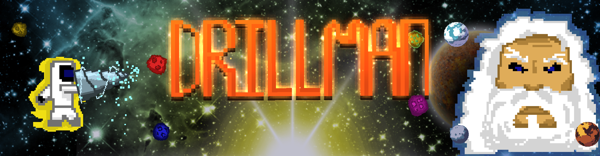
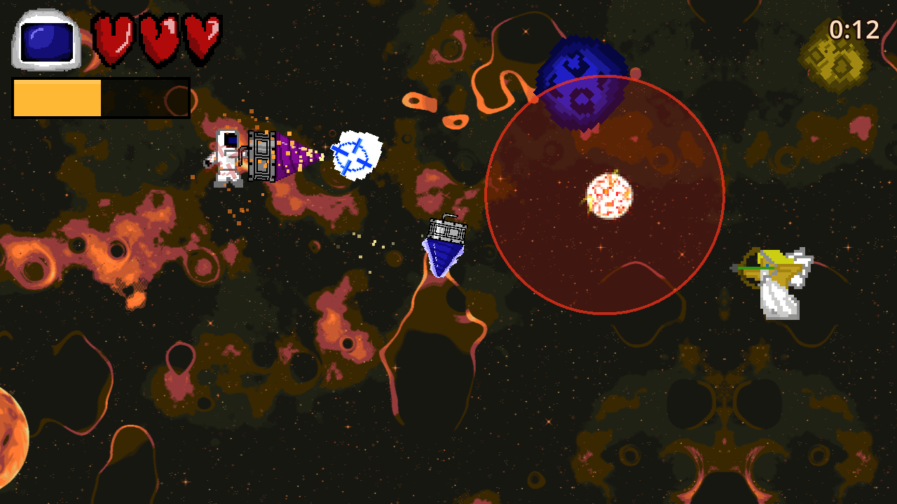
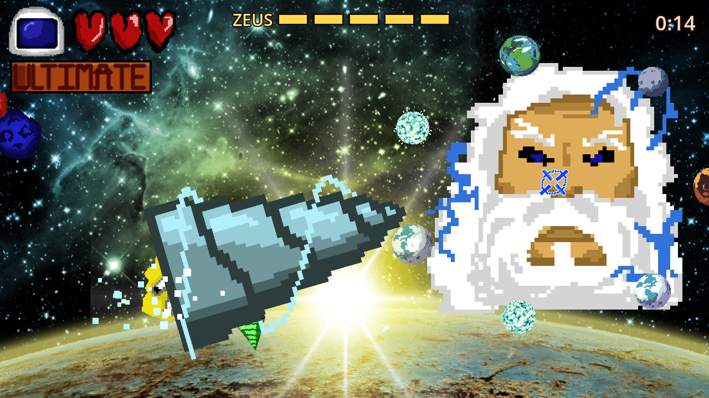
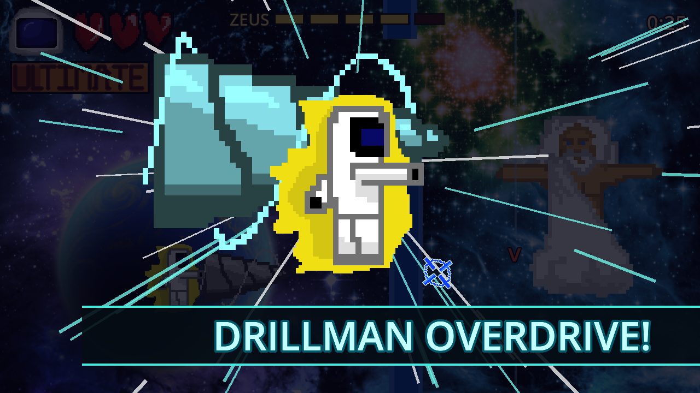

<p align="center">
  
</p>

# DrillMan

A pixel-art space endless runner made in **Godot 4.2**.

You're an employee of OREBIT™, sent into the cosmos with a drill to meet ever-increasing corporate quotas. There's just one problem: God isn't too happy about you strip-mining His creation.

<p align="center">
  
  
  
</p>

## Play

- **In your browser:** *(add your itch.io link here)*
- **Trailer:** *(add your YouTube link here)*

## Controls

| Input | Action |
|---|---|
| **W / S** (or ↑ / ↓) | Move up and down |
| **Mouse** | Aim your drill (touch asteroids to drill them) |
| **Space** | Activate your Ultimate when the bar is full |
| **Click / Space** | Fire the Ultimate drill |
| **Click / Space** | Next line in a cutscene (**Esc** skips) |

## Features

- **Endless mining:** asteroids get faster and denser the longer you survive, and the whole game speeds up over time.
- **Drill upgrades:** collect floating drills to move up the path bronze → green → red → purple → blue. Each new drill also restores a heart.
- **Ultimate bar:** every asteroid you mine fills it, and it can hold up to four bars. Spend one for a **DRILLMAN OVERDRIVE!** cutscene and a giant drill that smashes everything in its path.
- **Hazards:** archer angels lock on and fire arrows, and exploding suns blow up everything around them.
- **Boss fight:** at the 2:00 mark, Zeus arrives with orbiting planets and a lightning form. It takes five Ultimate hits to beat him, with voiced cutscenes before and after.
- **Fully voiced:** an intro cutscene, boss dialogue, and hurt and Ultimate voice lines. Sound effects, music and dialogue each have their own volume channel, and there are on/off switches in Settings.

## Running the project

1. Install **[Godot 4.2](https://godotengine.org/download/archive/4.2.2-stable/)** (standard build, not .NET).
2. Clone the repo:
   ```bash
   git clone https://github.com/opooladaniel/Drillman.git
   ```
3. Open Godot, click **Import**, and select `project.godot`. Godot rebuilds the `.godot/` cache on first open, which takes a minute.
4. Press **F5** to play. The game starts at the title screen.

`Scenes/boss_test.tscn` jumps straight to the boss fight for testing. It has these hotkeys:

| Key | Action |
|---|---|
| **L** | Lightning mode |
| **A** | Summon an angel |
| **S** | Spawn a sun |
| **U** | Fill the Ultimate bar |
| **I** | Invincibility |
| **R** | Restart |

### Soundtrack (not included)

The background music isn't in this repo because it's copyrighted. To hear it, put these two files in `Audio/Backing_Track/`:

- `One Punch Man OST - The Cyborg Fight (Genos' Theme).mp3`
- `Dragon Ball Z Dokkan Battle_ STR Super Saiyan 3 Goku Finish Skill OST (Extended).mp3`

### Web export

The project includes a **Web** export preset. Export from **Project → Export → Web**, then zip the output folder for itch.io. On itch.io, turn on **SharedArrayBuffer support**, which Godot 4.2 web builds need.

## Project structure

```
Scenes/    Game scenes (title, intro, main, HUD, boss, boss test)
Scripts/   GDScript for the player, hazards, boss, HUD, music, cutscenes
Sprites/   Pixel art: player, drills, asteroids, boss, angels, UI
Audio/     Sound effects (soundtrack folder is git-ignored)
Voice/     Voice lines for the intro, boss, angel and spaceman
Images/    Intro cutscene images
Themes/    UI theme
docs/      README images (ignored by Godot)
```

## Credits

*(Add your team here)*

The soundtrack is from *One Punch Man* and *Dragon Ball Z Dokkan Battle*, and belongs to its respective owners. It isn't distributed with this project.
